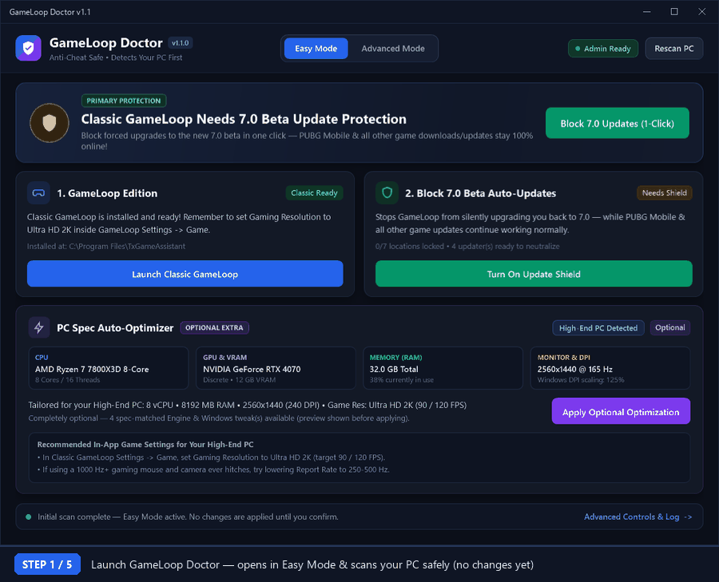
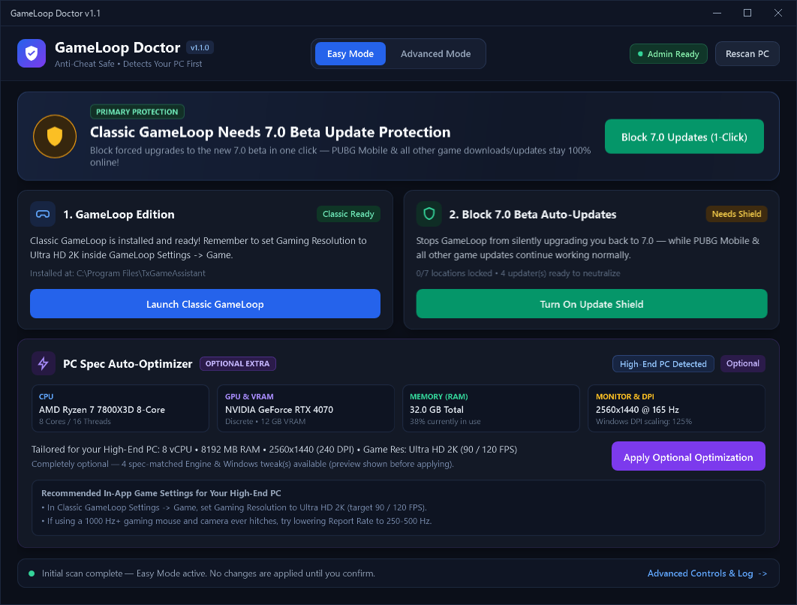
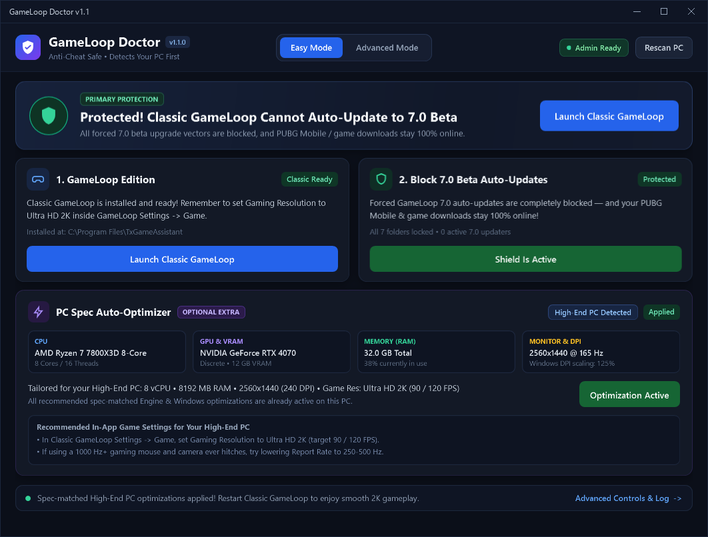
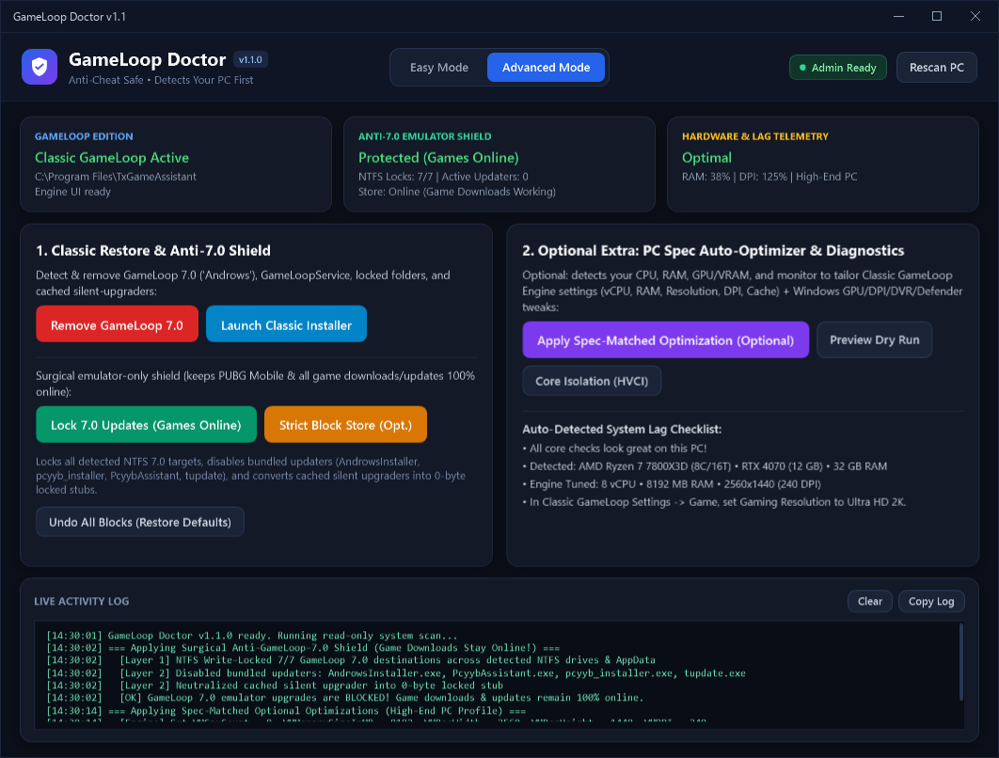

# GameLoop Doctor

**All-in-one, detect-first Windows Desktop App & PowerShell tool** built primarily to **block Classic GameLoop (`TxGameAssistant`) from silently auto-updating to the buggy GameLoop 7.0 ("Androws" beta)** — while keeping **PUBG Mobile & all other game downloads/updates 100% online** — plus an **Optional Extra** that auto-detects your PC specs to tailor Classic GameLoop settings for your hardware.

> **100% Anti-Cheat Safe & Detect-First:**
> - **Never touches game files:** Only manages Windows host folders, NTFS permissions, GameLoop's own UI preference registry keys, optional Firewall rules, and Windows GPU/DPI settings. It **never** modifies PUBG Mobile internal files (`UserCustom.ini`, `Active.sav`, `data.vhd`) or game memory.
> - **Preview before every change:** Automatically scans your PC's drives, hardware, and GameLoop installations first and shows a clear confirmation dialog (or `-DryRun` preview) before applying anything.
> - **Games stay 100% online:** Surgically neutralizes only the GameLoop 7.0 emulator upgraders without blocking `AppMarket.exe`, so installing and updating PUBG Mobile, Call of Duty Mobile, Free Fire, and other games works normally inside Classic GameLoop.

---

## Animated Walkthrough (How to Use)



---

## Screenshots

### Easy Mode (Default — Primary 7.0 Beta Blocker + Optional PC Spec Auto-Optimizer)
Opens in **Easy Mode** by default with a clean, beginner-friendly layout:



### Protected & Optionally Tuned State
Once protected, Classic GameLoop cannot auto-upgrade to 7.0 beta while PUBG Mobile and all game downloads stay online:



### Advanced Mode (Power Users — Full Telemetry, Dry Run, Undo & Live Log)
Switch anytime from the top segmented pill toggle for full NTFS/updater telemetry, **Preview Dry Run**, **Strict Block Store (Optional)**, **Undo All Blocks**, and the real-time activity log:



---

## Quick Start (3 Ways to Run — Zero Dependencies!)

Works out of the box on **any Windows 10 or Windows 11 PC** (no Python, Node, or .NET SDK required):

### Option 1 — One-Line PowerShell Command (Fastest)
1. Press `Win + X` and open **Terminal** (or **PowerShell**).
2. Paste and press **Enter**:
```powershell
irm https://raw.githubusercontent.com/nicefellow1234/gameloop-doctor/main/GameLoop-Doctor.ps1 -OutFile "$env:TEMP\GameLoop-Doctor.ps1"; powershell -ExecutionPolicy Bypass -File "$env:TEMP\GameLoop-Doctor.ps1"
```
3. Accept the Windows Administrator (UAC) prompt — the dark **Easy Mode** window opens automatically and runs a read-only scan of your PC.

### Option 2 — Standalone `.exe` (GitHub Releases)
1. Download **`GameLoop-Doctor.exe`** from [GitHub Releases](https://github.com/nicefellow1234/gameloop-doctor/releases).
2. Double-click **`GameLoop-Doctor.exe`** and click **Yes** on the Administrator prompt.

### Option 3 — Clone / Download ZIP
1. Download or clone this repository.
2. Double-click **`Launch-GameLoop-Doctor.bat`** to launch the desktop app.

---

## Step-by-Step Usage Instructions

### Case A — You Are Already on Classic GameLoop (Want to Stop Forced 7.0 Beta Updates)
1. Launch **GameLoop Doctor** (opens in **Easy Mode** and scans your PC without changing anything).
2. Click the green **`Block 7.0 Updates (1-Click)`** button.
3. Review the **Detect-First Preview** dialog showing the exact folders and bundled updaters detected on your PC, then click **Yes**.
4. Done! Your shield badge turns green (**`Protected`**):
   - **Layer 1 (All-Drive NTFS Lockdown):** Write-locks `Program Files\Tencent\GameLoop` & `GameLoopData` across every fixed NTFS drive plus `%APPDATA%\Tencent\GameLoop`, `%APPDATA%\Tencent\DeskUpdate`, and `%LOCALAPPDATA%\Tencent\GameLoop`.
   - **Layer 2 (Bundled & Silent Upgrader Neutralizer):** Disables Classic's bundled 7.0/client updaters (`AndrowsInstaller.exe`, `pcyyb_installer.exe`, `PcyybAssistant.exe`, `tupdate.exe`, `Update.exe`) and replaces any cached `com_tencent_gameloop_*.exe` silent upgrader with a 0-byte write/execute-denied stub.
   - **Layer 3 (Game Downloads Stay 100% Online):** `AppMarket.exe` is **not** blocked in Windows Firewall, so downloading new games and installing seasonal PUBG Mobile updates continue working automatically!

### Case B — Your PC Was Already Force-Upgraded to GameLoop 7.0 ("Androws" Beta)
1. Launch **GameLoop Doctor** — the top Hero banner automatically detects GameLoop 7.0 beta.
2. Click **`Remove 7.0 Beta Now`**, review the detected 7.0 components (`GameLoopService`, 7.0 folders, shortcuts, registry keys), and click **Yes**. *(Your Classic `GLP_installer*.exe` is never deleted.)*
3. Click **`Install Classic GameLoop`** to launch your detected Classic installer (or open `gameloop.com`), install Classic GameLoop (`TxGameAssistant`), and download your games.
4. Click **`Block 7.0 Updates (1-Click)`** so Classic GameLoop can never silently upgrade back to 7.0 beta.

### Optional Extra — Auto-Tune Settings for Your PC Specs
*(Completely optional — never runs unless you explicitly click it!)*
1. Look at the **`PC Spec Auto-Optimizer [OPTIONAL EXTRA]`** card at the bottom of Easy Mode.
2. Check your auto-detected hardware pills (**CPU**, **GPU & accurate 64-bit VRAM**, **RAM**, **Monitor & DPI**) and hardware tier (`Entry` / `Mid-Range` / `High-End` / `Ultra`).
3. Click **`Apply Optional Optimization`** to review and apply tailored settings for your PC:
   - **Classic GameLoop Engine Preferences:** `VMCpuCount`, `VMMemorySizeInMB` (never exceeds safe host limits), `VMResWidth` × `VMResHeight` (capped to your real monitor), `VMDPI`, Shader Cache, Render Optimization, VSync off, AA off, and Dedicated GPU priority.
   - **Windows Host Tweaks:** High-Performance discrete GPU pinning *(skipped automatically on integrated-only PCs)*, `HIGHDPIAWARE` *(when display scaling > 100%)*, Disable Fullscreen Optimizations, Xbox Game DVR off *(if currently enabled)*, and Windows Defender exclusions *(only if Windows Defender is active)*.
4. Restart Classic GameLoop if it was open so the updated engine settings take effect.

### Using Advanced Mode & Undo
- Switch to **`Advanced Mode`** in the top pill toggle anytime to:
  - Run **`Preview Dry Run`** (prints every planned change into the Live Activity Log without modifying anything).
  - Toggle **`Strict Block Store (Opt.)`** if you also want to block `AppMarket.exe` outbound in Windows Firewall (and **`Re-Allow Store Downloads`** whenever you want to update games).
  - Click **`Undo All Blocks (Restore Defaults)`** to cleanly remove every NTFS lock, 0-byte upgrader stub, firewall rule, and restore renamed `.disabled` updaters.

---

## Headless CLI Reference (Power Users)

```powershell
# Read-only PC & hardware diagnostics (no Admin required)
.\GameLoop-Doctor.ps1 -Diagnose

# Dry-run preview for any action (changes nothing)
.\GameLoop-Doctor.ps1 -RemoveGameLoop7 -DryRun
.\GameLoop-Doctor.ps1 -LockUpdates -DryRun
.\GameLoop-Doctor.ps1 -OptimizeWindows -DryRun

# Apply actions
.\GameLoop-Doctor.ps1 -RemoveGameLoop7    # Detect & remove GameLoop 7.0 beta
.\GameLoop-Doctor.ps1 -LockUpdates        # Primary: block 7.0 emulator upgrade (games stay online!)
.\GameLoop-Doctor.ps1 -OptimizeWindows    # Optional Extra: spec-matched Engine & Windows tweaks
.\GameLoop-Doctor.ps1 -StrictBlockStore   # Optional: also block AppMarket.exe outbound in Firewall
.\GameLoop-Doctor.ps1 -AllowStore         # Re-allow AppMarket.exe outbound if Strict Mode was enabled
.\GameLoop-Doctor.ps1 -UnblockAll         # Reverse all blocks cleanly
```

---

## Extra Tips for Lag-Free Gameplay

- **In-App Resolution:** Inside Classic GameLoop **Settings → Game**, match **Gaming Resolution** to the recommendation shown for your PC tier (`SD 720p`, `HD 1080p`, or `Ultra HD 2K`).
- **Close heavy VM/container tools** (Docker Desktop, WSL2, VMware, VirtualBox) before gaming to eliminate hypervisor CPU contention.
- **Windows Memory Integrity (HVCI):** Click **Core Isolation** in the app — turning Memory Integrity **OFF** (requires reboot) reduces virtualization overhead during emulator gameplay.
- **High Polling-Rate Mice (1000 Hz+):** If camera movement ever hitches on a 1000 Hz+ mouse (Logitech, Razer, SteelSeries, Pulsar, etc.), lowering Report Rate to **250–500 Hz** stabilizes virtual touch input.

---

## Building the Standalone `.exe` Locally

No .NET SDK or Visual Studio required — compiles using Windows' built-in .NET Framework 4.x compiler (`csc.exe`):
```powershell
powershell -ExecutionPolicy Bypass -File .\build-exe.ps1
```
Output: `dist\GameLoop-Doctor.exe` (single-file ~140 KB executable with `GameLoop-Doctor.ps1` embedded and UAC elevation manifest).

---

## License

[MIT](LICENSE) — free to use, audit, fork, and share with fellow gamers.
